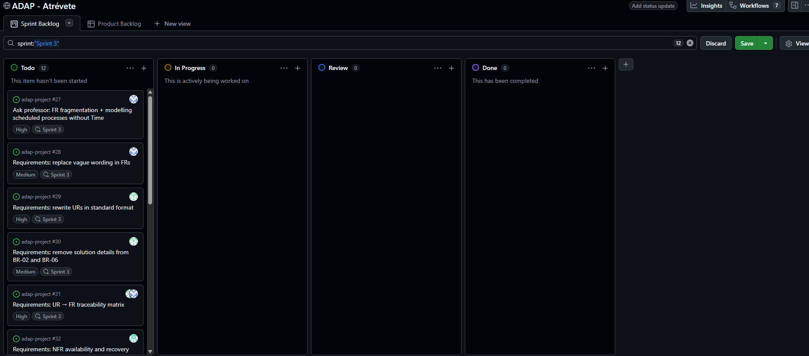
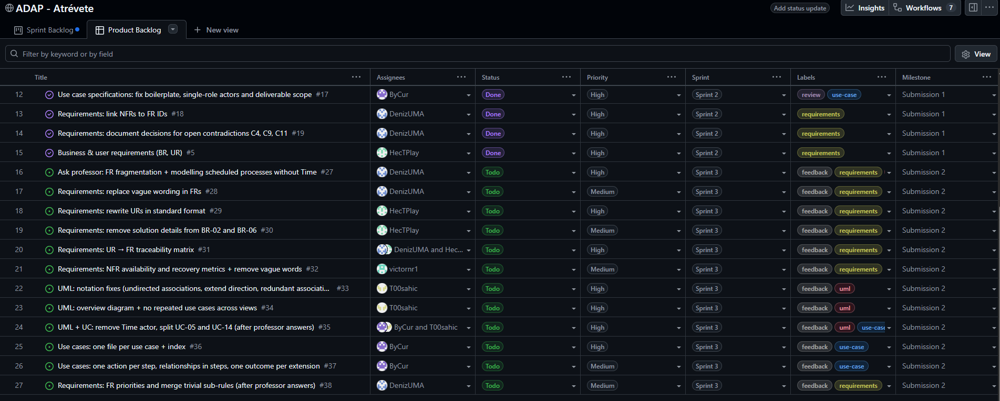
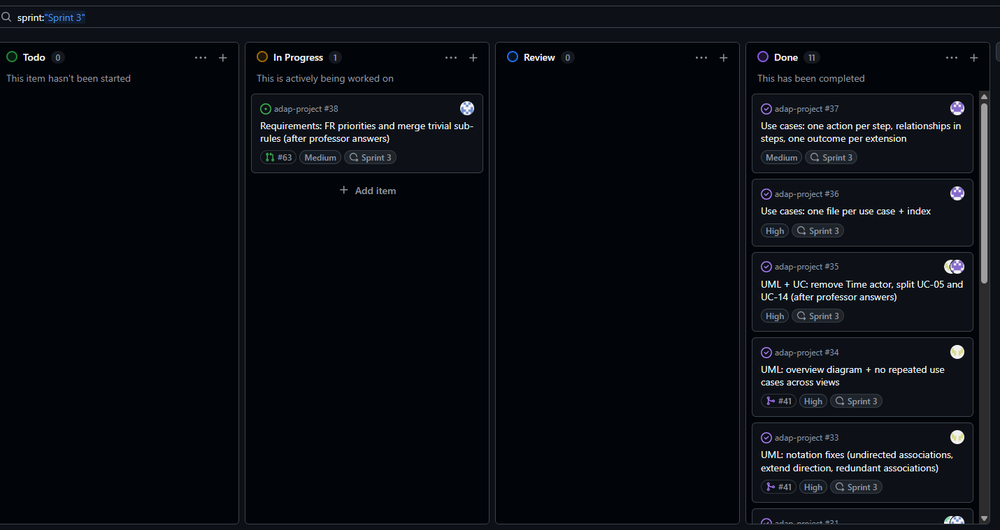
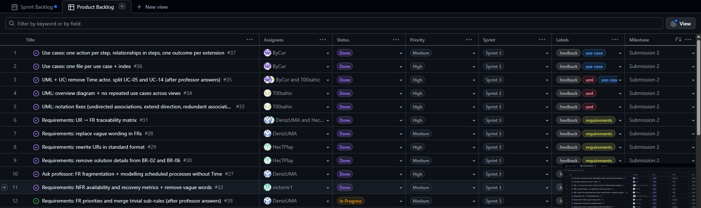
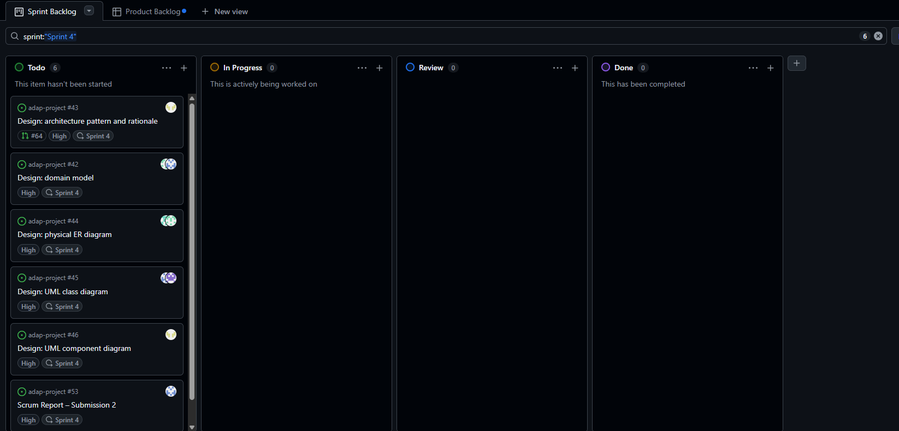
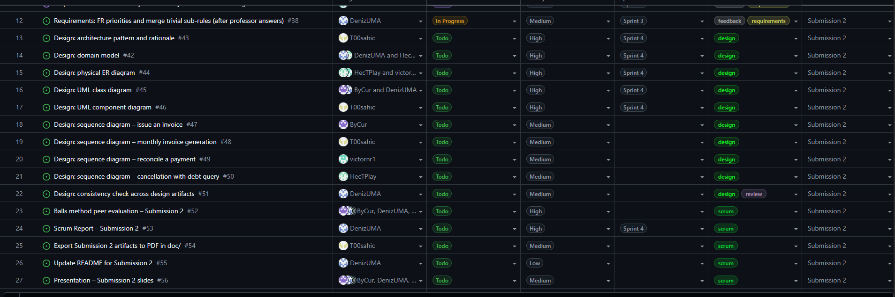

# Scrum Report: Delivery 2

## 1. Team Identification

**Team Atrévete**

| Full Name | GitHub User | Role |
| --- | --- | --- |
| Inan, Deniz Klaastjerk | `@DenizUMA` | Scrum Master |
| Ehmidi Alvarez, Adam Antonio | `@T00sahic` | Member |
| Encinas García, Héctor | `@HecTPlay` | Member |
| Navas Ramos, Víctor | `@victornr1` | Member |
| Pérez Arcas, Pablo | `@ByCur` | Member |

### Scrum Master election

For Submission 2 the team elected Deniz Inan as Scrum Master, replacing Adam, who held the role during Submission 1. The decision is based on the following evidence from Sprints 1 and 2:

- **Attendance and continuity:** Deniz attended all four recorded meetings (07/10, 14/10, 17/10 and the 20/10 tutoring session), so they have followed every planning, review and decision of the project first-hand.
- **Scrum tracking already in practice:** Deniz owned task #12 (Scrum Report) in Sprint 2. They wrote the record of the 17/10 meeting and added the Sprint 2 progress captures of the board, which are core duties of the Scrum Master.
- **Removing impediments:** The open contradictions in the client case were blocking the requirements. Deniz documented a justified team decision for each of them (C4, C9 and C11, task #19), backed by quotes from the client meeting.
- **Keeping the backlog workable:** Deniz consolidated the Functional Requirements from 147 to 59 and linked every Non-Functional Requirement to its related FRs (task #18), which unblocked the traceability review (#10).
- **Fast response to feedback:** On the day of the tutoring (20/10) Deniz applied the professor's comments to the Functional Requirements (sub-IDs for each rule, only the real contradictions kept) before the end of the day.
- **Role rotation:** Rotating the role lets a second member gain Scrum experience. It also avoids concentrating responsibility on Adam, who already managed the use case diagram, the PDF export and the Submission 1 delivery.

## 2. Work Organization

The team keeps the Scrum adaptation of Submission 1: each sprint lasts about one week and is closed by a meeting that holds the review and retrospective and plans the next sprint. Work is managed on GitHub Projects (board **ADAP - Atrévete**, milestone **Submission 2**). Applying the Submission 1 feedback, every task on the board now has:

- a **description** with its source (e.g. the feedback point it answers), what to change, where in the repository, and when it counts as done;
- a single, small scope and an **owner**, avoiding coarse-grained tasks that concentrate responsibility on one person;
- **labels** (`feedback`, `requirements`, `uml`, `use-case`), **priority**, **sprint**, and its **dependencies** on other tasks.

Every change reaches `main` through a pull request linked to its task and reviewed by another member. The board is captured at every sprint planning and every retrospective.

Responsibilities in Sprint 3 follow the authorship of each Submission 1 artifact, so each member fixes the feedback on the part they wrote: Héctor the Business and User Requirements, Deniz the Functional Requirements and the Scrum Report, Víctor the Non-Functional Requirements, Adam the use case diagram, and Pablo the use case specifications.

### Meetings

**28/10/2026 – 11:15 to 11:30** (Sprint 3 planning, in class)

* **Participants:** Deniz, Adam, Héctor, Víctor
* **Absent:** Pablo (informed of his tasks the same day through the team's WhatsApp group)
* **Topic:** Review of the Submission 1 feedback (grade 8.6) and planning of Sprint 3.
* **Results:** The feedback was split into 12 tasks (#27 to #38), each with a description, owner, labels, priority and the Submission 2 milestone. Since two feedback points conflict with the advice received in the 20/10 tutoring (fragmentation of the Functional Requirements and how to model scheduled processes without the Time actor), Deniz will ask the professor before that rework starts (#27); tasks #35 and #38 wait for the answer. The design tasks of Submission 2 will be added once the feedback fixes are under way.

**28/10/2026 – about 12:00** (questions to the professor, in class)

* **Participants:** Deniz and the professor
* **Topic:** The two Submission 1 feedback points that conflicted with the 20/10 tutoring (#27).
* **Results:** (1) The items under each FR must be sub-requirements, i.e. things the system does; business rules, descriptions and anything not about the system can be removed. (2) Time cannot be an actor: automatic scheduling is part of the system and its architecture. Both answers were recorded in #27, which was closed, and unblocked #35 and #38.

**04/11/2026 – 11:15 to 11:30** (Sprint 3 review and retrospective / Sprint 4 planning, in class)

* **Participants:** Deniz, Adam, Héctor, Víctor
* **Absent:** Pablo (informed of the decisions and his tasks through the team's WhatsApp group)
* **Topic:** Review of the Sprint 3 feedback fixes, retrospective, and planning of the Submission 2 design work in Sprint 4.
* **Results:** The sprint went smoothly because the team applied what it learned in Submission 1: small tasks with descriptions and owners, and questions to the professor before reworking. All feedback tasks except the FR priorities (#38) were finished; the finished pull requests (#59, #41, #60) were left to merge after the GitHub outage. The team agreed to stop committing directly to `main` and to send every change through a pull request with a reviewer. Sprint 4 was planned with the goal of completing the design core (see Section 3).

**11/11/2026 – 12:00 to 12:15** (Sprint 4 progress check, in class)

* **Participants:** Deniz, Adam, Héctor, Víctor
* **Absent:** Pablo (informed of the decisions through the team's WhatsApp group)
* **Topic:** Progress of the Sprint 4 design work on its planned end date.
* **Results:** Only part of the Sprint Goal was done: the domain model (#42, PR #62) and the FR priorities (#38, PR #63) were merged, the architecture (#43, PR #64) was approved but not merged, the class diagram (#45, PR #66) was a draft under review, and the ER diagram (#44) and component diagram (#46) were not started. Instead of carrying the design core over, the team decided to extend Sprint 4 until its goal is met and to close it with the review and retrospective then. During the meeting the architecture (PR #64) and the use case review follow-ups (PR #65) were merged, and the class diagram (PR #66) was reviewed. Adam opened the component diagram (PR #67) and Víctor and Héctor started the ER diagram. The Sprint 5 goal was proposed: finish and submit Submission 2 once the design core is merged.

### Product Backlog

Project board: **ADAP - Atrévete** (GitHub Projects). Milestone for all tasks: **Submission 2**.

| # | Task | Assignee | Priority | Label | Sprint | Start | Due | Status | Depends on |
| --- | --- | --- | --- | --- | --- | --- | --- | --- | --- |
| #27 | Ask professor: FR fragmentation + modelling scheduled processes without Time | Deniz | High | feedback, requirements, uml | Sprint 3 | 28/10 | 04/11 | Done | – |
| #28 | Requirements: replace vague wording in FRs | Deniz | Medium | feedback, requirements | Sprint 3 | 28/10 | 04/11 | Done (PR #40) | – |
| #29 | Requirements: rewrite URs in standard format | Héctor | High | feedback, requirements | Sprint 3 | 28/10 | 04/11 | Done (commit 1bf9c0d, references fixed in PR #60) | – |
| #30 | Requirements: remove solution details from BR-02 and BR-06 | Héctor | Medium | feedback, requirements | Sprint 3 | 28/10 | 04/11 | Done (commit 1f3c59c) | – |
| #31 | Requirements: UR → FR traceability matrix | Héctor, Deniz | High | feedback, requirements | Sprint 3 | 28/10 | 04/11 | In review (PR #60) | #29 |
| #32 | Requirements: NFR availability and recovery metrics + remove vague words | Víctor | Medium | feedback, requirements | Sprint 3 | 28/10 | 04/11 | Done (commit 7b5d6f0) | – |
| #33 | UML: notation fixes (undirected associations, extend direction, redundant associations) | Adam | High | feedback, uml | Sprint 3 | 28/10 | 04/11 | In review (PR #41) | – |
| #34 | UML: overview diagram + no repeated use cases across views | Adam | High | feedback, uml | Sprint 3 | 28/10 | 04/11 | In review (PR #41) | – |
| #35 | UML + UC: remove Time actor, split UC-05 and UC-14 | Adam, Pablo | High | feedback, uml, use-case | Sprint 3 | 28/10 | 04/11 | In review (PRs #41, #59) | #27, #36 |
| #36 | Use cases: one file per use case + index | Pablo | High | feedback, use-case | Sprint 3 | 28/10 | 04/11 | In review (PR #59) | – |
| #37 | Use cases: one action per step, relationships in steps, one outcome per extension | Pablo | Medium | feedback, use-case | Sprint 3 | 28/10 | 04/11 | In review (PR #59) | #36 |
| #38 | Requirements: FR priorities and merge trivial sub-rules | Deniz | Medium | feedback, requirements | Sprint 3 | 28/10 | 04/11 | In progress (sub-requirements done in PR #40; priorities pending) | #27 |

Status of the feedback tasks at the end of Sprint 3 (04/11/2026). "In review" means the work is finished in a pull request that was waiting to be merged (see Section 4, GitHub outage).

The Submission 2 design and delivery tasks were created on 28/10 in the product backlog, without a sprint; each sprint planning moves the selected tasks into the sprint.

| # | Task | Assignee | Priority | Label | Sprint | Status | Depends on |
| --- | --- | --- | --- | --- | --- | --- | --- |
| #42 | Design: domain model | Deniz, Héctor | High | design | Sprint 4 | Done (PR #62) | – |
| #43 | Design: architecture pattern and rationale | Adam | High | design | Sprint 4 | Done (PR #64, merged 11/11) | – |
| #44 | Design: physical ER diagram | Víctor, Héctor | High | design | Sprint 4 | Todo | #42 |
| #45 | Design: UML class diagram | Pablo, Deniz | High | design | Sprint 4 | Todo | #42 |
| #46 | Design: UML component diagram | Adam | High | design | Sprint 4 | Todo | #43 |
| #47 | Design: sequence diagram – issue an invoice | Pablo | Medium | design | Sprint 5 (planned) | Todo | #45, #46 |
| #48 | Design: sequence diagram – monthly invoice generation | Adam | Medium | design | Sprint 5 (planned) | Todo | #43, #45, #46 |
| #49 | Design: sequence diagram – reconcile a payment | Víctor | Medium | design | Sprint 5 (planned) | Todo | #45, #46 |
| #50 | Design: sequence diagram – cancellation with debt query | Héctor | Medium | design | Sprint 5 (planned) | Todo | #45, #46 |
| #51 | Design: consistency check across design artifacts | Deniz | Medium | design, review | Sprint 5 (planned) | Todo | #44–#50 |
| #52 | Balls method peer evaluation – Submission 2 | All members | High | scrum | Sprint 5 (planned) | Todo | – |
| #53 | Scrum Report – Submission 2 | Deniz | High | scrum | All sprints | In progress (PR #39) | – |
| #54 | Export Submission 2 artifacts to PDF in doc/ | Adam | Medium | scrum | Sprint 5 (planned) | Todo | #51 |
| #55 | Update README for Submission 2 | Deniz | Low | scrum | Sprint 5 (planned) | Todo | #54 |
| #56 | Presentation – Submission 2 slides | All members | Medium | scrum | Sprint 5 (planned) | Todo | – |
| #57 | Presentation – rehearsal with timer | All members | Medium | scrum | Sprint 5 (planned) | Todo | #56 |
| #58 | Submit .zip + repo URL to Campus Virtual – Submission 2 | Deniz | High | scrum | Sprint 5 (planned) | Todo | #54, #55, #53 |

## 3. Sprints Performed

### Sprint 3

* **Start date:** 28/10/2026
* **End date:** 04/11/2026
* **Sprint Goal:** Fix the Submission 1 feedback and start the basics of the Submission 2 design tasks.
* **Planned tasks:** #27 to #38 (feedback fixes, see the Product Backlog). #38 (FR priorities) was carried over to Sprint 4.
* **Completed tasks:** #27 (professor's answers), #28 (vague wording, PR #40), #29 (URs in standard format), #30 (BR-02 and BR-06), #32 (availability and recovery metrics). Finished and waiting to be merged on 04/11: #31 (PR #60), #33–#37 (PRs #41 and #59). In progress: #38 (sub-requirements done in PR #40, priorities pending) and the first draft of the domain model (#42).
* **Meetings held:** 28/10/2026 (11:15 to 11:30, planning), 28/10/2026 (questions to the professor) and 04/11/2026 (11:15 to 11:30, review and retrospective). See Section 2.
* **Issues encountered:** Two points of the Submission 1 feedback conflict with the advice received in the 20/10 tutoring: the fragmentation of the Functional Requirements (sub-IDs were suggested in the tutoring) and the modelling of scheduled processes. Pablo was absent from the planning meeting. Three changes were committed directly to `main` without a pull request, and one of them used FR identifiers that had just been renumbered. The finished pull requests waited several days because two of them were still drafts, and on 04/11 a GitHub outage blocked merging. The Submission 2 design tasks were not started.
* **Solutions applied:** The conflicting points were turned into a question to the professor (#27), and the tasks that depend on the answer (#35, #38) were marked as blocked so that no work is redone twice; the professor answered the same day. The broken references were fixed in PR #60, and the owner was asked to protect `main` so that every change needs a reviewed pull request. The drafts were marked ready on 04/11 and merged once GitHub recovered. The design core was planned for Sprint 4.

#### Board Status at Sprint Planning

#### Board Status at Sprint Retrospective

### Sprint 4

* **Start date:** 04/11/2026
* **End date:** 11/11/2026 (planned), extended on 11/11 until the Sprint Goal is met: [TODO: actual end date]
* **Sprint Goal:** Complete the design core of Submission 2: domain model, architecture pattern, physical ER diagram, class diagram and component diagram.
* **Planned tasks:** #42 domain model, #43 architecture pattern and rationale, #44 physical ER diagram, #45 class diagram, #46 component diagram, and #38 FR priorities (carried over from Sprint 3). The Scrum Report (#53) continues across all sprints.
* **Completed tasks:** [TODO: update at the end of the sprint]
* **Meetings held:** 04/11/2026 (11:15 to 11:30, planning) and 11/11/2026 (12:00 to 12:15, progress check). [TODO: + closing meeting]. See Section 2.
* **Issues encountered:** By the planned end date (11/11) only two of the six planned tasks were merged and nothing had reached `main` since 04/11. The architecture pull request (#64) had been approved on 04/11 but not merged, which kept the component diagram (#46) waiting; the ER diagram (#44) had no pull request; PR #65 had no reviewer assigned. [TODO: complete at the end of the sprint]
* **Solutions applied:** In the 11/11 progress check the team extended Sprint 4 until the design core is merged, instead of starting Sprint 5 with unfinished work. [TODO: complete at the end of the sprint]

#### Board Status at Sprint Planning

#### Board Status at Sprint Retrospective

[TODO: insert board screenshots at the end of Sprint 4]

## 4. Issues and Risks

**Sprint 3**

* **Conflicting guidance between the tutoring and the feedback.**
  * **Impact:** Reworking the Functional Requirements or the use case diagram in the wrong direction would waste effort and could be criticised again.
  * **Solution:** Ask the professor before the rework (#27) and keep the dependent tasks (#35, #38) blocked until the answer arrives. He answered on 28/10: sub-items must be sub-requirements (applied in PR #40), and scheduling is part of the system, not an actor (applied in PRs #41 and #59).
  * **Status:** Resolved.
* **Several members editing the same files.**
  * **Impact:** `requirements.md` is changed by #28, #29, #30, #31, #32 and #38, and the use case files by #35, #36 and #37, which can cause merge conflicts and broken references.
  * **Solution:** Every change goes through a pull request with a reviewer; #36 (one file per use case) is done before #35 and #37; any ID change is published with an old → new mapping table.
  * **Status:** Mitigated.
* **Absence from the planning meeting.**
  * **Impact:** Pablo did not take part in planning his tasks (#35, #36, #37).
  * **Solution:** His tasks were explained to him the same day through the team's WhatsApp group, and each of them has a full description on the board.
  * **Status:** Resolved.
* **Direct commits to `main` without review.**
  * **Impact:** Three changes reached `main` without a pull request (`1f3c59c`, `7b5d6f0`, `1bf9c0d`). The last one added UR traceability with FR identifiers from before PR #40, so five references pointed to removed or renumbered requirements; UR-14 pointed silently to a different requirement.
  * **Solution:** The references were fixed in PR #60, and the repository owner was asked to protect `main` so that every change needs a pull request with one approval. In the 04/11 meeting the whole team agreed to send every change through a pull request, and the same day the owner enabled branch protection on `main`, so changes can only reach it through a reviewed pull request.
  * **Status:** Resolved.
* **Finished work waiting in draft pull requests.**
  * **Impact:** The use case split (#59) and the diagram (#41) were finished by 30/10, but #59 stayed a draft, so neither reached `main` during the sprint.
  * **Solution:** Draft pull requests are marked ready as soon as the work is finished, and the Scrum Master checks the review queue at each meeting.
  * **Status:** Resolved.
* **Conflicting changes from the company rename.**
  * **Impact:** The rename to TurbineH (#61) was merged first and conflicted with the use case split (#59).
  * **Solution:** The branch of #59 was updated with `main`, keeping the new file structure and applying the rename to the 22 new contracts.
  * **Status:** Resolved.
* **GitHub outage on 04/11/2026.**
  * **Impact:** GitHub reported a partial outage of Pull Requests and degraded Git operations, so #59, #41 and #60 could not be merged at the end of the sprint.
  * **Solution:** The merges were tested locally (no conflicts), and the pull requests were merged once the service recovered, on 04/11/2026 between 11:22 and 11:23.
  * **Status:** Resolved.
* **Design work not started in Sprint 3.**
  * **Impact:** About two weeks remain before the delivery (week of 17/11) and no design artifact was in progress at the end of Sprint 3.
  * **Solution:** The design core (domain model, architecture, ER, class and component diagrams) is planned for Sprint 4, and a first draft of the domain model (#42) was prepared on 04/11 so that the ER and class diagrams can start.
  * **Status:** Pending.

## 5. Final Assessment

### Review and Retrospective

[TODO: complete at the end of Submission 2]

### Actions for Next Step

[TODO: complete at the end of Submission 2]
