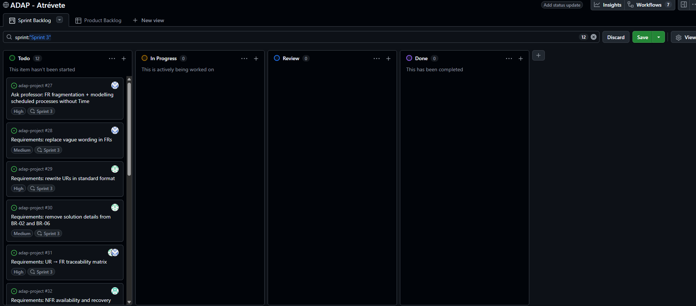
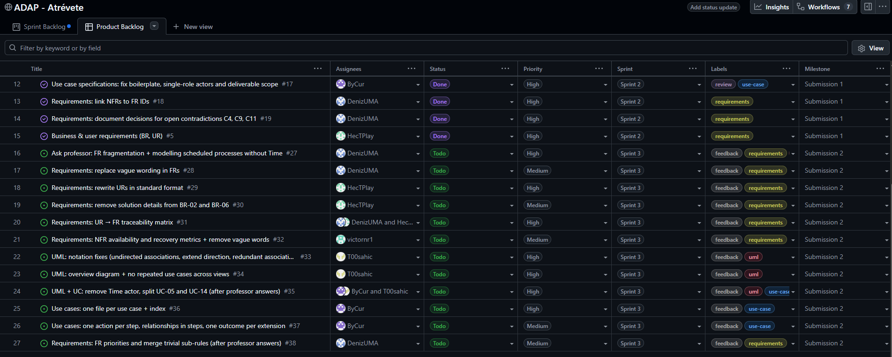

# Scrum Report: Delivery 2

## 1. Team Identification

**Team Atrévete**

| Full Name | GitHub User | Role |
| --- | --- | --- |
| Inan, Deniz Klaastjerk | `@DenizUMA` | Scrum Master |
| Ehmidi Alvarez, Adam Antonio | `@T00sahic` | Member |
| Encinas García, Héctor | `@HecTPlay` | Member |
| Navas Ramos, Víctor | `@victornr1` | Member |
| Pérez Arcas, Pablo | `@ByCur` | Member |

### Scrum Master election

For Submission 2 the team elected Deniz Inan as Scrum Master, replacing Adam, who held the role during Submission 1. The decision is based on the following evidence from Sprints 1 and 2:

- **Attendance and continuity:** Deniz attended all four recorded meetings (07/10, 14/10, 17/10 and the 20/10 tutoring session), so they have followed every planning, review and decision of the project first-hand.
- **Scrum tracking already in practice:** Deniz owned task #12 (Scrum Report) in Sprint 2. They wrote the record of the 17/10 meeting and added the Sprint 2 progress captures of the board, which are core duties of the Scrum Master.
- **Removing impediments:** The open contradictions in the client case were blocking the requirements. Deniz documented a justified team decision for each of them (C4, C9 and C11, task #19), backed by quotes from the client meeting.
- **Keeping the backlog workable:** Deniz consolidated the Functional Requirements from 147 to 59 and linked every Non-Functional Requirement to its related FRs (task #18), which unblocked the traceability review (#10).
- **Fast response to feedback:** On the day of the tutoring (20/10) Deniz applied the professor's comments to the Functional Requirements (sub-IDs for each rule, only the real contradictions kept) before the end of the day.
- **Role rotation:** Rotating the role lets a second member gain Scrum experience. It also avoids concentrating responsibility on Adam, who already managed the use case diagram, the PDF export and the Submission 1 delivery.

## 2. Work Organization

The team keeps the Scrum adaptation of Submission 1: each sprint lasts about one week and is closed by a meeting that holds the review and retrospective and plans the next sprint. Work is managed on GitHub Projects (board **ADAP - Atrévete**, milestone **Submission 2**). Applying the Submission 1 feedback, every task on the board now has:

- a **description** with its source (e.g. the feedback point it answers), what to change, where in the repository, and when it counts as done;
- a single, small scope and an **owner**, avoiding coarse-grained tasks that concentrate responsibility on one person;
- **labels** (`feedback`, `requirements`, `uml`, `use-case`), **priority**, **sprint**, and its **dependencies** on other tasks.

Every change reaches `main` through a pull request linked to its task and reviewed by another member. The board is captured at every sprint planning and every retrospective.

Responsibilities in Sprint 3 follow the authorship of each Submission 1 artifact, so each member fixes the feedback on the part they wrote: Héctor the Business and User Requirements, Deniz the Functional Requirements and the Scrum Report, Víctor the Non-Functional Requirements, Adam the use case diagram, and Pablo the use case specifications.

### Meetings

**28/10/2026 – 11:15 to 11:30** (Sprint 3 planning, in class)

* **Participants:** Deniz, Adam, Héctor, Víctor
* **Absent:** Pablo [TODO: how Pablo was informed of his tasks, e.g. team chat]
* **Topic:** Review of the Submission 1 feedback (grade 8.6) and planning of Sprint 3.
* **Results:** The feedback was split into 12 tasks (#27 to #38), each with a description, owner, labels, priority and the Submission 2 milestone. Since two feedback points conflict with the advice received in the 20/10 tutoring (fragmentation of the Functional Requirements and how to model scheduled processes without the Time actor), Deniz will ask the professor before that rework starts (#27); tasks #35 and #38 wait for the answer. The design tasks of Submission 2 will be added once the feedback fixes are under way.

[TODO: add the meeting that closes Sprint 3 in the same format]

### Product Backlog

Project board: **ADAP - Atrévete** (GitHub Projects). Milestone for all tasks: **Submission 2**.

| # | Task | Assignee | Priority | Label | Sprint | Start | Due | Status | Depends on |
| --- | --- | --- | --- | --- | --- | --- | --- | --- | --- |
| #27 | Ask professor: FR fragmentation + modelling scheduled processes without Time | Deniz | High | feedback, requirements, uml | Sprint 3 | 28/10 | 04/11 | Todo | – |
| #28 | Requirements: replace vague wording in FRs | Deniz | Medium | feedback, requirements | Sprint 3 | 28/10 | 04/11 | Todo | – |
| #29 | Requirements: rewrite URs in standard format | Héctor | High | feedback, requirements | Sprint 3 | 28/10 | 04/11 | Todo | – |
| #30 | Requirements: remove solution details from BR-02 and BR-06 | Héctor | Medium | feedback, requirements | Sprint 3 | 28/10 | 04/11 | Todo | – |
| #31 | Requirements: UR → FR traceability matrix | Héctor, Deniz | High | feedback, requirements | Sprint 3 | 28/10 | 04/11 | Todo | #29 |
| #32 | Requirements: NFR availability and recovery metrics + remove vague words | Víctor | Medium | feedback, requirements | Sprint 3 | 28/10 | 04/11 | Todo | – |
| #33 | UML: notation fixes (undirected associations, extend direction, redundant associations) | Adam | High | feedback, uml | Sprint 3 | 28/10 | 04/11 | Todo | – |
| #34 | UML: overview diagram + no repeated use cases across views | Adam | High | feedback, uml | Sprint 3 | 28/10 | 04/11 | Todo | – |
| #35 | UML + UC: remove Time actor, split UC-05 and UC-14 | Adam, Pablo | High | feedback, uml, use-case | Sprint 3 | 28/10 | 04/11 | Todo | #27, #36 |
| #36 | Use cases: one file per use case + index | Pablo | High | feedback, use-case | Sprint 3 | 28/10 | 04/11 | Todo | – |
| #37 | Use cases: one action per step, relationships in steps, one outcome per extension | Pablo | Medium | feedback, use-case | Sprint 3 | 28/10 | 04/11 | Todo | #36 |
| #38 | Requirements: FR priorities and merge trivial sub-rules | Deniz | Medium | feedback, requirements | Sprint 3 | 28/10 | 04/11 | Todo | #27 |

[TODO: add the Submission 2 design tasks (ER diagram, class diagram, component diagram, sequence diagrams) when they are created, and update the status column at the end of each sprint.]

## 3. Sprints Performed

### Sprint 3

* **Start date:** 28/10/2026
* **End date:** 04/11/2026
* **Sprint Goal:** Fix the Submission 1 feedback and start the basics of the Submission 2 design tasks.
* **Planned tasks:** #27 to #38 (feedback fixes, see the Product Backlog).
* **Completed tasks:** [TODO: update at the end of the sprint]
* **Meetings held:** 28/10/2026 (11:15 to 11:30, planning) [TODO: + closing meeting]. See Section 2.
* **Issues encountered:** Two points of the Submission 1 feedback conflict with the advice received in the 20/10 tutoring: the fragmentation of the Functional Requirements (sub-IDs were suggested in the tutoring) and the modelling of scheduled processes. Pablo was absent from the planning meeting. [TODO: complete during the sprint]
* **Solutions applied:** The conflicting points were turned into a question to the professor (#27), and the tasks that depend on the answer (#35, #38) were marked as blocked so that no work is redone twice. [TODO: complete during the sprint]

#### Board Status at Sprint Planning

#### Board Status at Sprint Retrospective

[TODO: insert board screenshots at the end of Sprint 3]

## 4. Issues and Risks

**Sprint 3**

* **Conflicting guidance between the tutoring and the feedback.**
  * **Impact:** Reworking the Functional Requirements or the use case diagram in the wrong direction would waste effort and could be criticised again.
  * **Solution:** Ask the professor before the rework (#27) and keep the dependent tasks (#35, #38) blocked until the answer arrives.
  * **Status:** Pending.
* **Several members editing the same files.**
  * **Impact:** `requirements.md` is changed by #28, #29, #30, #31, #32 and #38, and the use case files by #35, #36 and #37, which can cause merge conflicts and broken references.
  * **Solution:** Every change goes through a pull request with a reviewer; #36 (one file per use case) is done before #35 and #37; any ID change is published with an old → new mapping table.
  * **Status:** Mitigated.
* **Absence from the planning meeting.**
  * **Impact:** Pablo did not take part in planning his tasks (#35, #36, #37).
  * **Solution:** [TODO: e.g. tasks explained in the team chat on 28/10 and confirmed by Pablo]
  * **Status:** [TODO]

## 5. Final Assessment

### Review and Retrospective

[TODO: complete at the end of Submission 2]

### Actions for Next Step

[TODO: complete at the end of Submission 2]
