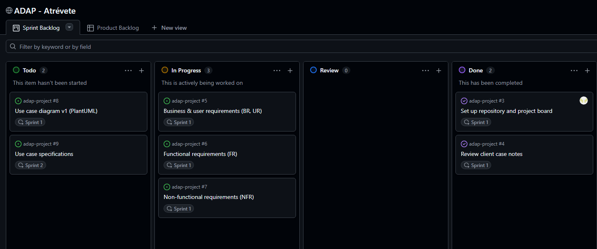
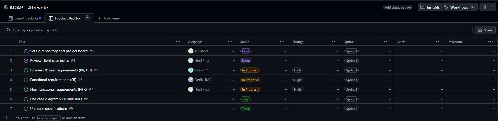
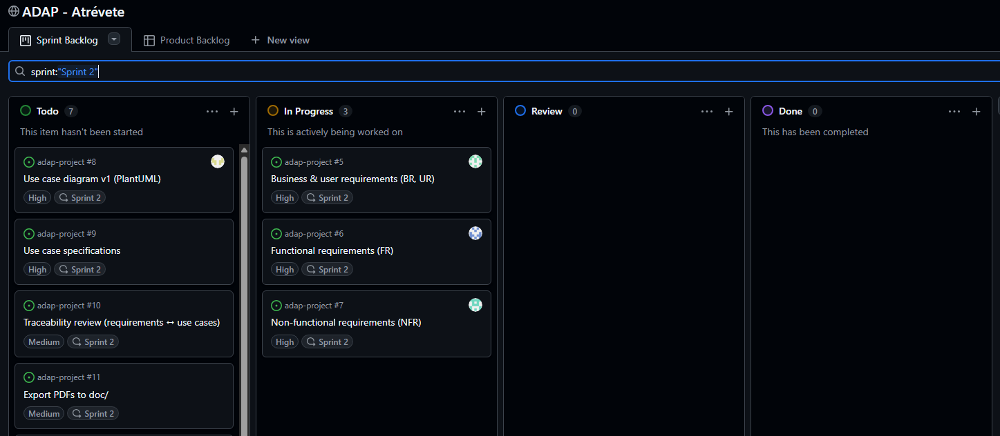
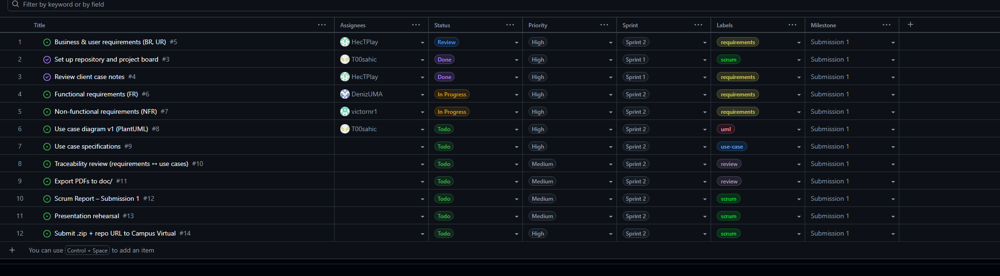
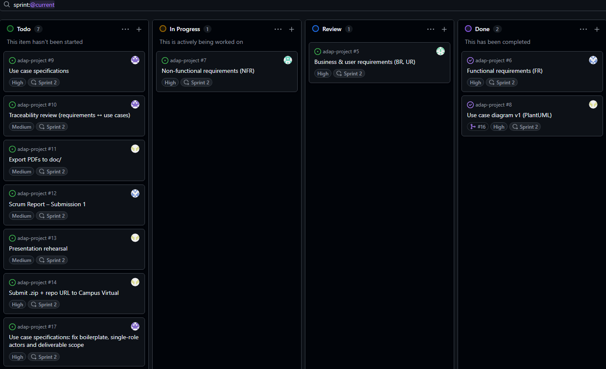
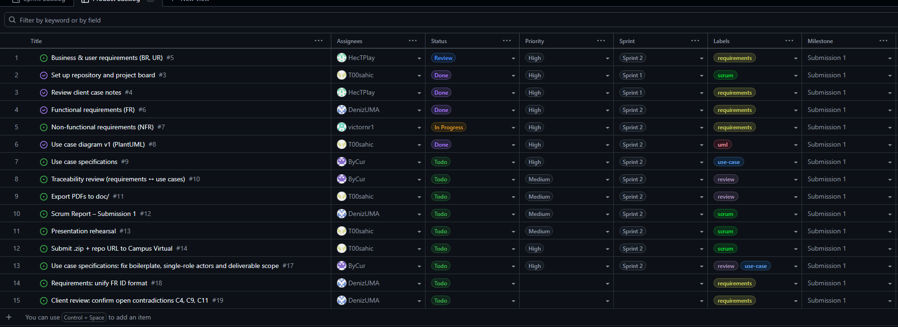
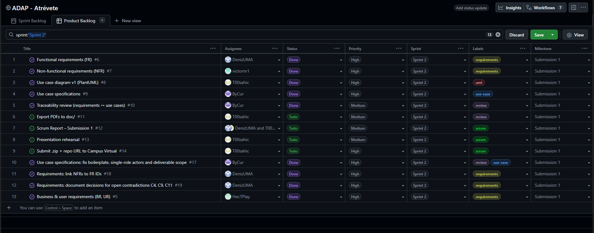
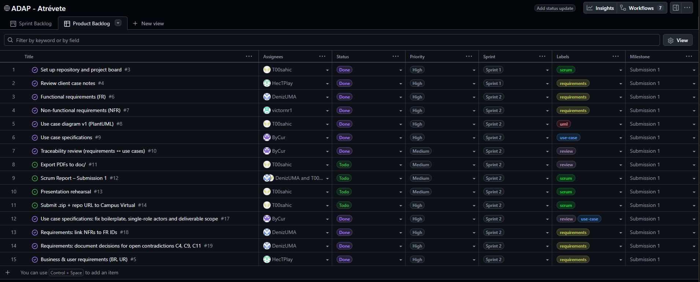

# Scrum Report: Delivery 1

## 1. Team Identification

**Team Atrévete**

| Full Name | Role |
| --- | --- |
| Ehmidi Alvarez, Adam Antonio | Scrum Master |
| Inan, Deniz Klaastjerk | Member (Functional Requirements) |
| Navas Ramos, Víctor | Member (Non-Functional Requirements) |
| Encinas García, Héctor | Member (Business & User Requirements) |
| Pérez Arcas, Pablo | Member (Use Case Specifications & Traceability) |

Adam was chosen as Scrum Master by the team because his leadership and organization skills were considered valuable and essential for the development of this project.

## 2. Work Organization

The team adapted Scrum to the analysis and design nature of the project. Each sprint runs from one team meeting to the next: every meeting closes the current sprint (review and retrospective) and plans the following one, which results in sprints of about one week. Work was managed on GitHub Projects (board **ADAP - Atrévete**), using a Sprint Backlog board view and a Product Backlog table view, where each task has an assignee, status, priority, sprint, label and milestone. Contributions to the repository were made through branches and pull requests linked to their board tasks.

Responsibilities were split by artifact: Héctor drafted the Business and User Requirements, Deniz the Functional Requirements, Víctor the Non-Functional Requirements, and Pablo the Use Case Specifications and the integration/traceability review. As Scrum Master, Adam set up the repository and the project board, created new tasks, prepared each sprint and is in charge of the use case diagram. The team worked together in person during lab sessions, where meetings were held and day-to-day coordination happened directly.

### Meetings

**07/10/2026 – 11:00 to 11:15** (Sprint 1 planning)

* **Participants:** Deniz, Adam, Héctor, Víctor
* **Topic:** Project organization approach, division of tasks, analysis of the client requirements.
* **Results:** Each participant was given a role to complete while the Scrum Master finished setting up the essential working environment (GitHub repository, GitHub Projects, etc.).

**14/10/2026 – 11:00 to 11:15** (Sprint 1 review and retrospective / Sprint 2 planning)

* **Participants:** Deniz, Adam, Héctor, Víctor
* **Topic:** Requirements analysis and division of tasks.
* **Results:** The requirements were divided by type and each type was assigned to one person: Héctor will draft the Business and User Requirements, Deniz the Functional Requirements and Víctor the Non-Functional Requirements. Adam is responsible for adding new tasks and preparing the next sprint. Unfinished requirements tasks (#5, #6, #7) and the use case diagram (#8) were carried over to Sprint 2.

**17/10/2026 – 16:00 to 19:00** (Sprint 2 review and retrospective, online call)

* **Participants:** Deniz, Adam, Héctor
* **Topic:** Review of Sprint 2 progress, integration of the requirements with the use case diagram and specifications, and the remaining work for Submission 1. The team worked on the open tasks during the call.
* **Results:** The Functional Requirements (#6) and the use case diagram v1 (#8, PR #16) were completed, and the draft of 24 use case specifications with the integration review (PR #15) was merged into `main`. The Business and User Requirements (#5) are under review and the Non-Functional Requirements (#7) are still in progress. Three new tasks were created: #17 to fix the boilerplate, actors and scope of the use case specifications (Pablo), #18 to link the Non-Functional Requirements to the FR identifiers (Deniz), and #19 to document team decisions for the open contradictions C4, C9 and C11 (Deniz). The remaining delivery tasks were assigned: #12 Scrum Report to Deniz, and #11 Export PDFs, #13 Presentation rehearsal and #14 Submission to Adam. Once #17 and #18 are merged, the final FR identifiers will be linked to the use cases to complete the traceability review (#10). The tasks still pending at the end of the call were assigned to the other members, who completed them afterwards (see Sprint 2).

**20/10/2026** (tutoring session with the professor / Sprint 2 closing)

* **Participants:** PARTICIPANTS_TBC
* **Topic:** Review of the Submission 1 artifacts with the professor before the submission.
* **Results:** Following the professor's feedback, the team simplified the artifacts the same day: the Business Requirements were reduced to six and the non-functional content was moved out of them (Héctor), the rules inside each Functional Requirement were given their own sub-IDs and only the real contradictions were kept (Deniz), the User Requirements were grouped from 30 into 14 (Héctor), the 24 use cases were consolidated into 18 contracts with the diagram updated to match (Pablo, PR #24), and the 18 use cases were renumbered consecutively as UC-01 to UC-18 (Adam, PR #25).

### Product Backlog

Project board: **ADAP - Atrévete** (GitHub Projects). Milestone for all tasks: **Submission 1**.

| # | Task | Assignee | Priority | Label | Sprint |
| --- | --- | --- | --- | --- | --- |
| #3 | Set up repository and project board | Adam | High | scrum | Sprint 1 |
| #4 | Review client case notes | Héctor | High | requirements | Sprint 1 |
| #5 | Business & user requirements (BR, UR) | Héctor | High | requirements | Sprint 1 → 2 |
| #6 | Functional requirements (FR) | Deniz | High | requirements | Sprint 1 → 2 |
| #7 | Non-functional requirements (NFR) | Víctor | High | requirements | Sprint 1 → 2 |
| #8 | Use case diagram v1 (PlantUML) | Adam | High | uml | Sprint 1 → 2 |
| #9 | Use case specifications | Pablo | High | use-case | Sprint 2 |
| #10 | Traceability review (requirements ↔ use cases) | Pablo | Medium | review | Sprint 2 |
| #11 | Export PDFs to doc/ | Adam | Medium | review | Sprint 2 |
| #12 | Scrum Report - Submission 1 | Deniz, Adam | Medium | scrum | Sprint 2 |
| #13 | Presentation rehearsal | Adam | Medium | scrum | Sprint 2 |
| #14 | Submit .zip + repo URL to Campus Virtual | Adam | High | scrum | Sprint 2 |
| #17 | Use case specifications: fix boilerplate, single-role actors and deliverable scope | Pablo | High | review, use-case | Sprint 2 |
| #18 | Requirements: link NFRs to FR IDs | Deniz | High | requirements | Sprint 2 |
| #19 | Requirements: document decisions for open contradictions C4, C9, C11 | Deniz | High | requirements | Sprint 2 |

## 3. Sprints Performed

### Sprint 1

* **Start date:** 07/10/2026
* **End date:** 14/10/2026
* **Sprint Goal:** Set up the project infrastructure (repository and project board), analyze the client case, and produce a first draft of the requirements and the use case diagram.
* **Planned tasks:** #3 Set up repository and project board; #4 Review client case notes; #5 Business & user requirements (BR, UR); #6 Functional requirements (FR); #7 Non-functional requirements (NFR); #8 Use case diagram v1 (PlantUML)
* **Completed tasks:** #3 Set up repository and project board; #4 Review client case notes
* **Meetings held:** 07/10/2026 (11:00 to 11:15, planning) and 14/10/2026 (11:00 to 11:15, review and retrospective). See Section 2.
* **Issues encountered:** Mild delay in analyzing the requirements, which delayed the completion of the UML use case diagram. Difficulty coordinating schedules for meetings outside class hours.
* **Solutions applied:** Requirements tasks were given high priority and carried over to Sprint 2; teamwork and meetings were concentrated in the lab sessions.

#### Board Status at Sprint Planning

No capture of the board was taken at the Sprint 1 planning meeting, because the board was still being set up by the Scrum Master during that meeting.

#### Board Status at Sprint Retrospective

### Sprint 2

* **Start date:** 14/10/2026
* **End date:** 20/10/2026
* **Sprint Goal:** Finish and review the requirements, complete the use case diagram and specifications, verify traceability between them, and prepare the Submission 1 deliverables and presentation.
* **Planned tasks:** #8 Use case diagram v1 (PlantUML); #9 Use case specifications; #10 Traceability review (requirements ↔ use cases); #11 Export PDFs to doc/; #12 Scrum Report - Submission 1; #13 Presentation rehearsal; #14 Submit .zip + repo URL to Campus Virtual; plus #5, #6 and #7 carried over from Sprint 1. Added during the sprint (17/10/2026): #17, #18 and #19.
* **Completed tasks:** #5 Business & user requirements (BR, UR); #6 Functional requirements (FR); #7 Non-functional requirements (NFR); #8 Use case diagram v1 (PlantUML), split into four views (PR #16); #9 Use case specifications (PRs #15 and #22); #10 Traceability review (PRs #20 and #21); #17 Use case specifications fixes (PR #22); #18 NFR ↔ FR links; #19 Decisions for contradictions C4, C9 and C11. During the sprint the Functional Requirements were consolidated from 147 to 59 (merging closely related sub-requirements and moving 11 to *Out of Scope*), and the User Requirements without a use case (quotations and historical invoice migration) were removed, leaving 10 BR, 30 UR and 59 FR, all traced to at least one use case. After the tutoring session on 20/10/2026 the artifacts were simplified: 6 BR, 14 UR, 85 parent FR with 112 sub-rules, 7 NFR and 18 use cases (UC-01 to UC-18), with every requirement still covered by at least one use case (PRs #24 and #25). Still open for the submission: #11 Export PDFs, #12 Scrum Report, #13 Presentation rehearsal and #14 Submission.
* **Meetings held:** 14/10/2026 (11:00 to 11:15, planning), 17/10/2026 (16:00 to 19:00, review and retrospective) and 20/10/2026 (tutoring session with the professor). See Section 2.
* **Issues encountered:** The use case specifications were drafted before the requirement identifiers (UR/FR) were final and before the use case diagram was complete, so traceability is still provisional. Later in the sprint, renumbering the Business, User and Functional Requirements broke the references from the use cases more than once. The Non-Functional Requirements had no links to specific Functional Requirements, because the FR identifiers were not final when they were written. The client interviews contain contradictory statements (C4, C9, C11) that the team cannot resolve on its own. On 20/10/2026 the User Requirements were regrouped directly on `main` while the use case consolidation was still open in a pull request, so the two changes conflicted.
* **Solutions applied:** The draft was submitted as a pull request (#15) together with an integration review listing discrepancies between sources, pending decisions and a provisional traceability matrix, to be updated once the requirements are finalized. The team decided to keep the hierarchical FR format (FR1, FR1.1…), which shows the parent requirement of each sub-requirement, and task #18 was repurposed to link each NFR to its related FRs; and the contradictions were documented in `requirements.md` with a proposed interpretation for each, and task #19 records a justified team decision for each one, as the client allowed. After each renumbering, the use case references were updated from an old → new mapping confirmed by the author of those requirements, in a single change (PRs #20 and #21). The 20/10/2026 conflict was resolved by merging `main` into the use case pull request and mapping the 18 contracts to the 14 new User Requirements with the same criteria as their author (PR #24).

#### Board Status at Sprint Planning

#### Board Status at Sprint Retrospective

Board at the Sprint 2 review and retrospective (17/10/2026):

Board after the tasks assigned at the closing meeting were completed (18/10/2026), before the submission tasks:

## 4. Issues and Risks

**Sprint 1**

* **Mild delay in analyzing the requirements**, which delayed the completion of the UML use case diagram.
  * **Impact:** #5, #6, #7 and #8 could not be finished in Sprint 1.
  * **Solution:** Requirements tasks were set to high priority and carried over to Sprint 2.
  * **Status:** Resolved: #5, #6, #7 and #8 were completed in Sprint 2.
* **Difficulty coordinating schedules for team meetings outside class hours.**
  * **Impact:** Few opportunities for synchronous work outside class.
  * **Solution:** Meetings and joint work were concentrated in the lab sessions, where the whole team works together in person.
  * **Status:** Resolved.

**Sprint 2**

* **Use case specifications drafted in parallel with unfinished requirements.**
  * **Impact:** The traceability between requirements and use cases is provisional, and the specifications may not match the final requirement IDs or the use case diagram.
  * **Solution:** Pablo's integration review (PR #15) recorded the discrepancies and pending decisions. Once the requirements were final, every use case was traced to the current BR, UR, FR and NFR IDs (PRs #20 and #21), and the specifications were completed (PR #22).
  * **Status:** Resolved.
* **Pull request #15 has no reviewer assigned.**
  * **Impact:** The use case specifications cannot be merged into `main` until they are reviewed.
  * **Solution:** The Scrum Master reviewed the pull request and merged it into `main` on 17/10/2026; the follow-up fixes were moved to task #17.
  * **Status:** Resolved.
* **Requirement identifier format and missing NFR ↔ FR links.**
  * **Impact:** The Functional Requirements use hierarchical IDs (FR1, FR1.1…) while the template placeholders used FR-01, and the NFRs still read "Functional requirement IDs pending confirmation", so traceability between NFRs and FRs was incomplete.
  * **Solution:** The team kept the hierarchical format because it shows the parent of each sub-requirement. Task #18 was repurposed to link each NFR to its related FRs, and it was completed.
  * **Status:** Resolved.
* **Contradictory client statements between the two interviews.**
  * **Impact:** Requirements related to cancellation with outstanding debt (C4), the working calendar (C9) and the marketing use of retained data (C11) are based on the team's interpretation and may change.
  * **Solution:** The client is not reachable outside the reviews, and in the extended meeting he asked the team to record the uncertainty and propose an interpretation, accepting decisions that are documented, justified and consistent with his stated needs. Task #19 recorded a team decision for C4, C9 and C11 in `requirements.md`, each backed by a quote from the extended meeting and marked to be validated at the next client review.
  * **Status:** Mitigated.
* **Requirement IDs renumbered after the use cases referenced them.**
  * **Impact:** Renumbering the BR, consolidating the FR (147 → 59) and inserting or removing UR left use case references pointing to wrong or missing requirements.
  * **Solution:** Each renumbering was mapped old → new and confirmed by the author of those requirements, then applied to all use case references in one change and checked so that every cited ID exists and every requirement is covered (PRs #20 and #21).
  * **Status:** Resolved.
* **Late simplification of the artifacts after the tutoring session (20/10/2026).**
  * **Impact:** On the day of the tutoring the BR, UR, FR and use cases all changed at once, and the User Requirements were committed directly to `main` while the use case consolidation (PR #24) was still under review. The pull request no longer merged cleanly and its contracts cited User Requirements that no longer existed.
  * **Solution:** `main` was merged into the pull request, the 18 contracts were mapped to the 14 new User Requirements, and the specification PDF was regenerated (PR #24). The use cases were then renumbered UC-01 to UC-18 with an original → current ID table (PR #25).
  * **Status:** Resolved.

## 5. Final Assessment

### Review and Retrospective

* **What was achieved:** The version control repository and the project board were set up, team roles were defined, the requirements were drafted (with the Functional Requirements completed), the use case diagram was completed in four views, and after the tutoring session the artifacts were simplified to 18 use case specifications (UC-01 to UC-18) traced to the final requirements (6 BR, 14 UR, 85 FR with 112 sub-rules and 7 NFR), with every requirement covered by at least one use case.
* **Problems encountered:** A delay in the initial requirements analysis, and having to work on the use cases in parallel with requirements that were not yet final.
* **What worked well:** The fast GitHub setup, a clear division of tasks by artifact, working together in the lab, and using pull requests linked to board tasks.
* **What should be improved:** Faster initial organization, earlier drafting of requirements, assigning every task on the board at sprint planning, and reviewing pull requests promptly. In Sprint 2 the team also learned to fix requirement IDs before other artifacts reference them, and to publish an equivalence table whenever an ID changes. The changes made after the tutoring also showed that every change, including small ones, should go through a pull request rather than directly to `main`.

### Actions for Next Step

For Submission 2, the team will plan each sprint with explicit dates and goals from the start, assign every task to a member at sprint planning, capture the board at both planning and retrospective, require a reviewer on every pull request, and begin the design artifacts (ER diagram, class diagram, sequence diagrams, architecture diagram) using the Submission 1 requirements and use cases as a base.